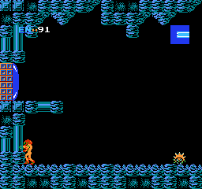
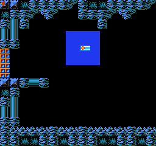
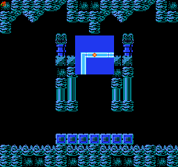
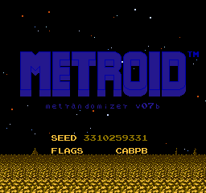
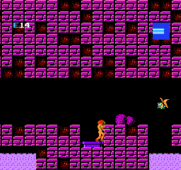
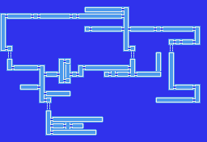
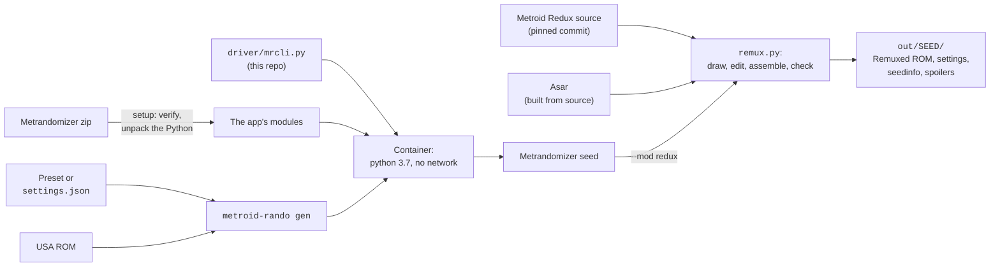

# Metroid Remuxed

A randomized Zebes every game, with a map drawn for each seed that fills in as you
explore, and any seed reproducible from its seed number and settings file.

Two community projects, combined:

- **[Metrandomizer](https://www.romhacking.net/utilities/1437/)** (Hex4F) builds a new Zebes
  for every seed: it rearranges Brinstar, Norfair, Kraid's lair, Ridley's lair and part of
  Tourian, and shuffles every item. It is a Windows program.
- **[Metroid Redux](https://github.com/ShadowOne333/Metroid-Redux)** (ShadowOne333) carries
  the map from **Metroid + Saving** (snarfblam): a small map in the HUD and a scrollable map
  on the pause screen.

Redux only patches the original ROM, and its map is a hand-drawn picture of the original
Zebes, so neither fits a randomized world. Metroid Remuxed runs Metrandomizer headless on
Linux, then draws each seed's own map with Redux's tiles and assembles Redux's map code onto
the seed.

<table>
<tr>
<td></td>
<td></td>
<td></td>
</tr>
<tr>
<td align="center">The corner map, filling in as you explore</td>
<td align="center">Paused: only where you have been</td>
<td align="center">With <code>:no-fog</code>, the whole layout</td>
</tr>
<tr>
<td></td>
<td></td>
<td></td>
</tr>
<tr>
<td align="center">Seed and flags on the title screen</td>
<td align="center">Random palettes from the harder presets</td>
<td align="center">One seed's world, drawn for its map</td>
</tr>
</table>

New here? Start with [docs/getting-started.md](docs/getting-started.md) (about 20 minutes).
Something broken? See [docs/troubleshooting.md](docs/troubleshooting.md).

> [!IMPORTANT]
> This repo contains **none** of Metrandomizer, Metroid Redux or the ROM. Download
> `Metrandomizer v07b.zip` yourself from romhacking.net, which blocks scripted downloads;
> `metroid-rando setup` checks its SHA-256 and unpacks it. Metroid Redux (GPL-3) and the Asar
> assembler are fetched from source at pinned commits by `metroid-rando setup-redux`. You
> supply your own unmodified *Metroid (USA)* ROM.

## Quick start

```sh
./bin/metroid-rando setup "Metrandomizer v07b.zip"   # once: verify and unpack the app
./bin/metroid-rando setup-redux                      # once: Metroid Redux and Asar, for --mod redux

export MR_ROM="/path/to/Metroid (USA).nes"
./bin/metroid-rando gen --preset 01-return-to-zebes --mod redux --out out
```

The result is `out/<SEED>/`: the ROM, its `settings.json`, `seedinfo.txt` and spoiler maps.

## How it fits together



| Piece | What it is |
|---|---|
| `bin/metroid-rando` | The command you run. Verifies and unpacks the app, maps paths into the container, runs Remuxed. |
| `driver/mrcli.py` | Sets the app's config, runs its generator as the Randomize button does (`Game()` then `Game.randomize()`), and writes the ROM, settings, seed info and three spoiler maps. |
| `presets/` | Five settings files, from one star to five. |
| `mods/redux/` | Metroid Remuxed: `remux.py` and the pinned commits (`PINS`). Its [README](mods/redux/README.md) documents every edit, the RAM map and the safety checks. |
| `tools/zebes.py` | Reads a seed's world (room grid, doors, elevators) and draws its map with Redux's tiles. |
| `$MR_HOME` | `~/.local/share/metrandomizer`: the unpacked app, Metroid Redux and Asar. |

## What Remuxed adds to a seed

| Feature | Source | What you get |
|---|---|---|
| Corner map | Metroid + Saving `MinimapPos.asm` (rewritten) | The rooms around Samus in the HUD, with a blinking blip |
| Pause map | Metroid + Saving `Map_RAM.asm` | A 7×7-room window centred on Samus; the D-pad scrolls it across Zebes |
| A map of this seed | `tools/zebes.py` | Each room drawn as corridor, shaft or single room, with its doors, and the dotted elevator links between areas |
| Fog of war | Remuxed | A room shows once Samus has been in it, an elevator once she has stood next to it. `--mod redux:no-fog` shows the whole map. |

The explored map lasts until power-off, deaths included. Metroid has no save files, so
nothing keeps it after power-off. An emulator save state does keep it.

## Commands

| Command | What it does |
|---|---|
| `metroid-rando setup ZIP` | Verify `Metrandomizer v07b.zip` and unpack its Python modules |
| `metroid-rando setup-redux` | Fetch Metroid Redux and Asar at the commits in `mods/redux/PINS`, verify Asar's SHA-256, build Asar |
| `metroid-rando options` | List every setting and its allowed values |
| `metroid-rando gen [OPTIONS]` | Generate one seed |

| `gen` option | Meaning |
|---|---|
| `--preset NAME` | `presets/NAME.json` |
| `--settings FILE` | Any settings file, such as the `settings.json` beside an earlier seed |
| `--seed SEED` | A seed number. Omit for a random one. |
| `--mod redux[:no-fog]` | Add the map, drawn for this seed. Fog of war unless `:no-fog`. |
| `--out DIR` | Output directory, default `./out`. Each seed gets its own folder. |
| `--name NAME` | ROM file name, without `.nes` |
| `--rom FILE` | The base ROM, or set `MR_ROM` |
| `-v` | Show each attempt |

Each seed folder holds the ROM, `settings.json`, `seedinfo.txt` (version, seed and flag
string) and `spoilers/` with three maps, least to most revealing: `1-outline.svg`,
`2-placeholders.svg` and `3-everything.svg`.

The ROM must be the unmodified **Metroid (USA)**, 131,088 bytes, SHA-1 of the PRG/CHR data
`FDBFC7871962F72A1EF57E5A7E456164FB93430B`.

## The presets

All five keep three quality-of-life fixes on: no pause when you collect an item, the Ice
Beam no longer cancels the Wave Beam, and A+B+Select+Start resets the game.

| Preset | Title | Difficulty | Map | Health | Pickups | Damage taken | Palettes |
|---|---|---|---|---|---|---|---|
| `01-return-to-zebes` | Return to Zebes | ★☆☆☆☆ | Very low complexity | 99 | ×10 | ×0.5 | Original |
| `02-colors-of-zebes` | Colors of Zebes | ★★☆☆☆ | Low | 99 | ×5 | ×1 | Random |
| `03-lost-expedition` | The Lost Expedition | ★★★☆☆ | Normal | 30 | ×2 | ×1 | Random |
| `04-hostile-planet` | Hostile Planet | ★★★★☆ | High | 30 | ×1 | ×2 | Random |
| `05-mother-brains-labyrinth` | Mother Brain's Labyrinth | ★★★★★ | Very high | 30 | ×0.5 | ×3 | Random |

Presets 3 to 5 also use the app's smaller status bar. "Random" palettes draw from the app's
23 colour schemes. Edit a preset by editing its JSON; `metroid-rando options` lists the
allowed values.

## Reproducing a seed

The seed number plus `settings.json` reproduce the game exactly; the flag string on the
title screen and in `seedinfo.txt` confirms the settings match.

```sh
metroid-rando gen --settings OLD/settings.json --seed OLDSEED --mod redux --out /tmp/check
cmp OLD/*.nes /tmp/check/OLDSEED/*.nes && echo identical
```

Checked on 2026-10-14: `--preset 01-return-to-zebes --seed 3310259331 --mod redux` rebuilt
a ROM byte-identical to one made earlier. With `--mod redux`, the result also depends on the
commits in `mods/redux/PINS`.

## Design notes and gotchas

> [!CAUTION]
> **Every seed has its own world, so the map is drawn for each one.** Metroid + Saving's map
> is a picture of the original Zebes; on a seed it shows rooms that are not there. Seed 01
> changes 597 of the 1,024 cells of the world map. `tools/zebes.py` walks the seed's world
> the way the game scrolls it and draws every room from that.

- **Remuxed is assembled, not patched.** `remux.py` expands the seed to 256 KB, assembles
  Redux's map code onto it with a few source edits, and adds a loader that copies the map
  into battery RAM. Every byte it changes in the original banks must be one Metrandomizer
  left alone, or the build stops. Details, and the measured RAM map, are in
  [mods/redux/README.md](mods/redux/README.md).
- **Save states across builds.** A save state brings back the map code of the build it was
  made with. After updating a Remuxed ROM, use the emulator's Restart once. The loader also
  checks a build ID and repairs a stale state at the next area change.
- **Some seeds cannot fit the map.** The generator raises "Bad seed! Not enough room to
  spawn Kraid's boss room" or "No space to put an elevator to Ridley". In the GUI you click
  Randomize again. Without `--seed`, the wrapper does the same and retries up to 20 times. A
  seed you chose yourself fails with that message.
- **The seed must be text inside the app.** Metrandomizer writes its log with
  `" seed " + seed`, so a numeric seed crashes it after the map is built. The driver passes it
  as a string.
- **Spoiler maps do not change the ROM.** The ROM is always built at the most detailed spoiler
  level, so the flag string on the title screen does not depend on the maps.
- **No Samus sprite option.** The app has none. Themes come from map complexity, difficulty
  and palettes.

## Legal

The code in this repo is under the [MIT License](LICENSE): the wrapper, the driver, the
presets and the Remuxed tools, and nothing else.

*Metrandomizer* belongs to its author, Hex4F, and is distributed by romhacking.net; no part
of it is included here. *Metroid Redux* is GPL-3 (ShadowOne333), including the map from
*Metroid + Saving* by snarfblam; Remuxed fetches its source and never redistributes it. Asar
is built from its own source.

No ROMs are included. *Metroid* is a trademark of Nintendo. This project is not affiliated
with or endorsed by Nintendo, Hex4F, snarfblam or ShadowOne333.
